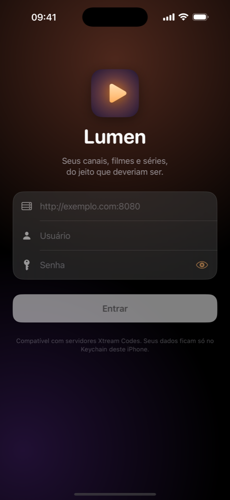
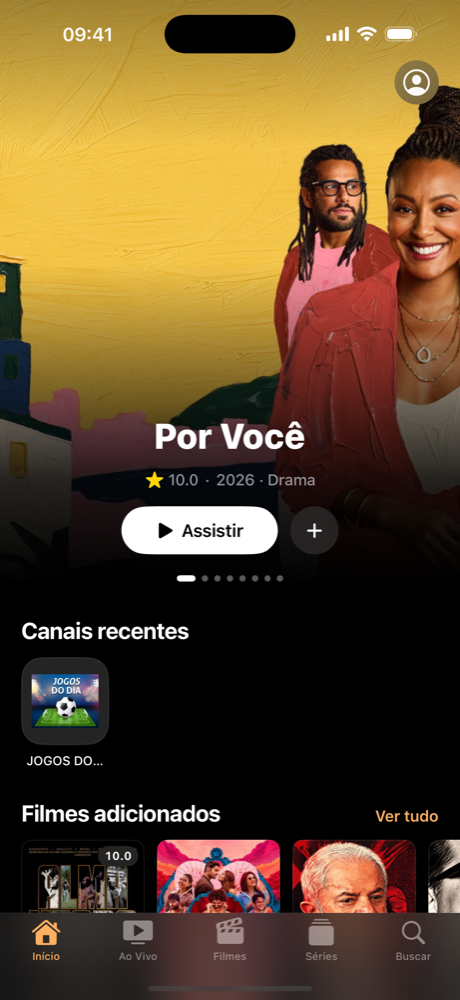
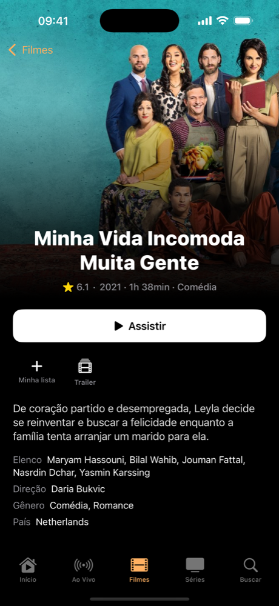
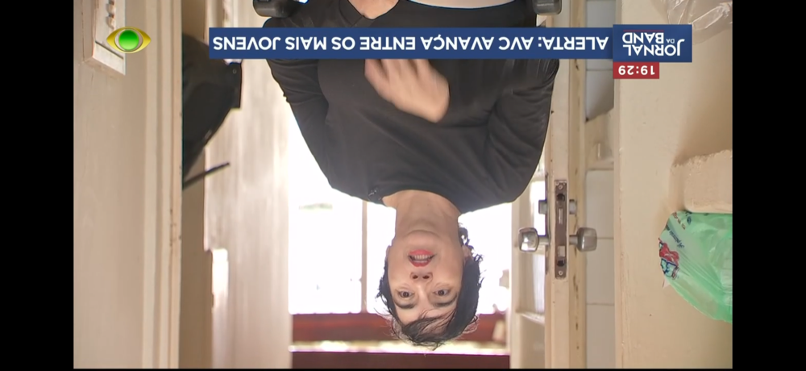

<p align="center">
  
</p>

<h1 align="center">Lumen</h1>

<p align="center">
  An IPTV app for iPhone that looks and feels like it was made by Apple.<br>
  Native SwiftUI · Xtream Codes · AVPlayer + VLC · Liquid Glass ready
</p>

<p align="center">
  
  
  
</p>
<p align="center">
  
</p>

## Why

Most IPTV players on iOS are ports of Android apps: tiny tap targets, lists of 30,000 items with no
artwork, players that freeze on the first unsupported codec. Lumen is a native SwiftUI app built around
three ideas: **browse like the TV app**, **play anything**, and **never lose your place**.

## Features

**Library**
- Home with a featured carousel, *Continue Watching*, recent channels, recently added movies and series
- Movies and Series organised into shelves by category, with full grids, sorting and filtering
- Rich detail pages: backdrop, rating, runtime, genre, cast, director, in-app YouTube trailer
- Series with season picker, episode stills, per-episode progress and a smart *Continue S1:E4* button
- Live TV with category chips, favourites, recents, inline search and now-playing EPG when available
- Global search across channels, movies and series (accent- and case-insensitive)
- *My List* for movies, series and channels

**Player**
- Two engines behind one UI: **AVPlayer** (Picture in Picture, AirPlay, efficient HLS) and
  **VLC** for everything else (MKV, AVI, raw MPEG-TS, exotic codecs)
- Automatic fallback: if AVPlayer can't open a stream, Lumen hands it to VLC at the same position
- Custom controls: double-tap to seek ±10s (stacks), Apple-style scrubber with buffer indicator,
  pinch to fill/fit, swipe for brightness, screen lock
- Audio track and subtitle selection, playback speed, aspect modes
- Live: channel zapping, channel list panel, automatic reconnect when the stream drops
- Series: *Next Episode* card in the last seconds and optional autoplay
- Resume from where you left off; lock-screen and Control Center controls

**Under the hood**
- Lenient decoding of Xtream Codes responses (panels mix strings, numbers and nulls freely)
- Catalog cached on disk: opens instantly, refreshes in the background
- Image pipeline with downsampling, memory + disk cache and TMDB size optimisation
- Credentials stored in the Keychain, never in source

## Requirements

- Xcode 16.4+ (Xcode 26 recommended: enables Liquid Glass and deploys to iOS 26)
- iOS 18.0+
- [XcodeGen](https://github.com/yonaskolb/XcodeGen) if you change `project.yml`

## Running on your iPhone

```bash
git clone https://github.com/andrealvimc/lumen-iptv.git
cd lumen-iptv
open Lumen.xcodeproj
```

1. In Xcode, select the **Lumen** target → *Signing & Capabilities* → choose your Team
   (a free Apple ID works; change the bundle identifier if it's taken).
2. Plug in your iPhone, enable **Developer Mode** (Settings → Privacy & Security).
3. Pick your iPhone as the run destination and press **⌘R**.
4. On first launch, trust the developer under Settings → General → VPN & Device Management.

Then sign in with your provider's server URL, username and password.

> With a free Apple ID the app expires after 7 days; just run it again from Xcode.

## Project layout

```
Lumen/
  App/         entry point, root navigation, orientation handling
  Core/        models, Xtream client, catalog/state (AppModel), playback types
  Player/      engine protocol, AVPlayer + VLC engines, PlayerModel, PlayerView
  Views/       login, home, live, movies, series, details, search, settings
  Components/  cards, shelves, image pipeline, trailer sheet, glass helpers
```

## Disclaimer

Lumen is a player. It does not provide, host or link to any content. Use it only with
services and streams you are authorised to access.
